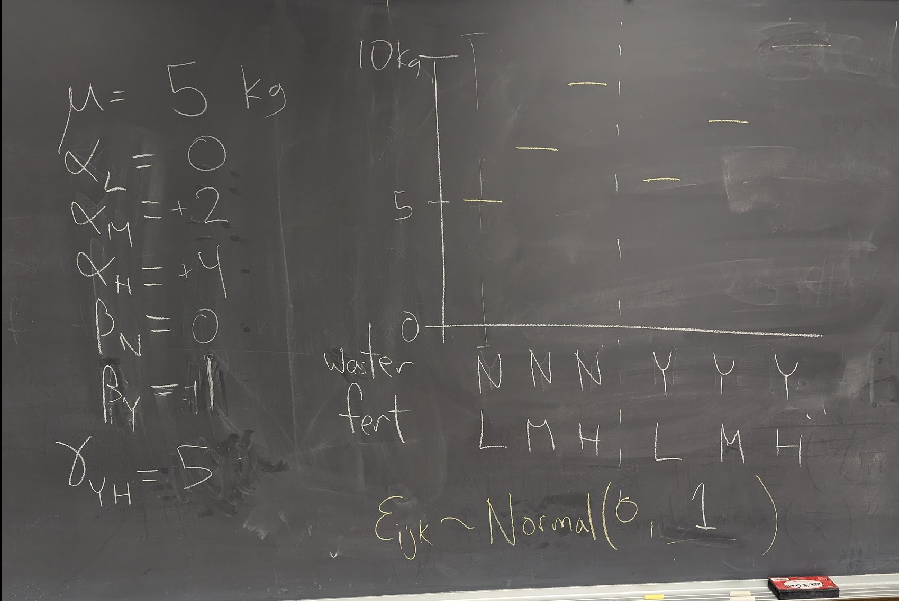
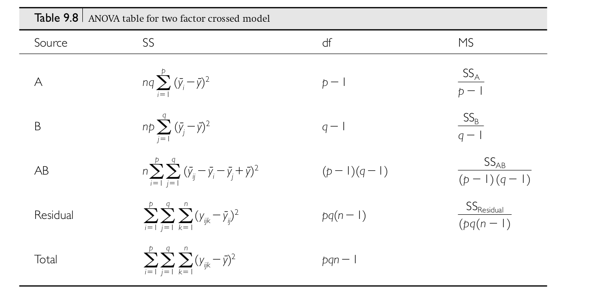

```{r setup, include=FALSE}
fig.dim <- 4
knitr::opts_chunk$set(fig.width=2*fig.dim,
                      fig.cap="",
                      fig.height=fig.dim,
                      fig.align='center')
set.seed(23)
library(matrixStats)
library(tidyverse)
```

# Outline

##

Linear models...

1. with categorical variables (multivariate ANOVA)
2. with continuous variables (least-squares linear models)
3. and likelihood (where's "least-squares" come from).

# Multivariate ANOVA


## The "factorial ANOVA model"

:::{.smaller}

Say we have $n$ observations coming from combinations of *two* factors,
so that the $k$th observation in the $i$th group of factor $A$ and the $j$th group of factor $B$ is
$$\begin{equation}
    Y_{ijk} = \mu + \alpha_i + \beta_j + \gamma_{ij} + \epsilon_{ijk} ,
\end{equation}$$
where

- $\mu$: overall mean
- $\alpha_i$: mean deviation of group $i$ of factor A from $\mu$
- $\beta_j$: mean deviation of group $j$ of factor B from $\mu$
- $\gamma_{ij}$: mean deviation of combination $i + j$ from $\mu + \alpha_i + \beta_j$, and
- $\epsilon_{ijk}$: what's left over ("error", or "residual")

. . .

In words,
$$\begin{equation} \begin{split}
    \text{(value)} &= \text{(overall mean)} + \text{(A group mean)}
    \\ &\qquad {}
    + \text{(B group mean)} + \text{(AB group mean)} + \text{(residual)}
\end{split}\end{equation}$$

:::

## Example: pumpkin pie

We're looking at how mean pumpkin weight depends on both

- fertilizer input, and
- late-season watering

. . .

So, we

1. divide a large field into many plots
2. randomly assign plots to either "high", "medium", or "low" fertilizer, and
3. independently, assign plots to either "no late water" or "late water"; then
4. plant a fixed number of plants per plot,
5. grow pumpkins and measure their weight.

## Questions:

> 1. How does mean weight depend on fertilizer?
> 2. ... or, on late-season water?
> 3. Does the effect of fertilizer depend on late-season water?
> 4. How much does mean weight differ between different plants in the same conditions?
> 5. ... and, between *plots* of the same conditions?
> 6. How much does weight of different pumpkins on the same plant differ?

. . .

*draw the pictures*

## First, a simplification

{.finger width="15%"} 
Ignore any "plant" and "plot" effects.

*(e.g., only one pumpkin per vine and one plot per combination of conditions)*

## 

Say that $i=1, 2, 3$ indexes fertilizer levels (low to high),
and $j=1, 2$ indexes late watering (no or yes), and
$$\begin{equation}\begin{split}
    Y_{ijk} 
    &=  \text{(weight of $k$th pumpkin in plot with conditions $i$, $j$)} \\
    &= \mu + \alpha_i + \beta_j + \gamma_{ij} + \epsilon_{ijk} ,
\end{split}\end{equation}$$
where

- $\mu$: typical pumpkin weight
- $\alpha_i$: average effect of fertilizer level $i$
- $\beta_j$: average effect of water condition $j$
- $\gamma_{ij}$: average deviation of combination $ij$
- $\epsilon_{ijk}$: random, mean-zero noise


## Making it real with simulation

A good way to get a better concrete understanding of something
is by *simulating* it --

. . .

by writing code to generate a (random) dataset that you design to look, more or less
like what you expect the real data to look like.

. . .

This lets you explore statistical power, choose sample sizes, etcetera...
but also makes you realize things you hadn't, previously.

## First, make up some numbers

::: {.columns}
:::::: {.column width=60%}

- $\mu = 5$ kg
- $\alpha_\text{low} = 0$  kg
- $\alpha_\text{med} = 2$  kg
- $\alpha_\text{high} = 4$  kg
- $\beta_\text{no water} = 0$  kg
- $\beta_\text{water} = 1$  kg
- $\gamma_{\text{high, water}} = 5$ kg
- $\epsilon_{ijk} \sim$Normal(mean=0, sd=1kg)

:::
:::::: {.column width=50%}



:::
::::::


## Next, a data format

```{r data_fromat}
pumpkins <- expand.grid(
          fertilizer=c("low", "medium", "high"),
          water=c("no water", "water"),
          plot=1:4,
          plant=1:5,
          weight=NA)
head(pumpkins)
```

## Now, compute the average values

```{r avgs}
params <- list(
    mu = 5, # all units are kg
    alpha = c(low=0, medium=2, high=4),
    beta = c("no water"=0, water=1),
    sigma = 1
)
params$gamma <- rep(0, 6)
names(params$gamma) <- outer(c("low", "medium", "high"), c("no water", "water"), paste, sep=",")
params$gamma["high,water"] <- 5

pumpkins$condition <- paste(pumpkins$fertilizer, pumpkins$water, sep=",")
pumpkins$mean_weight <-
    params$mu +
    params$alpha[pumpkins$fertilizer] +
    params$beta[pumpkins$water] +
    params$gamma[pumpkins$condition]

head(pumpkins)
```

## Finally, simulate the actual weights

```{r sim_pumpkins}
set.seed(123)
pumpkins$weight <- rnorm(nrow(pumpkins), mean=pumpkins$mean_weight, sd=params$sigma)
write.table(pumpkins, file="data/pumpkins.tsv", sep="\t")

pumpkins |> ggplot(aes(x=fertilizer, y=weight, color=water)) + geom_boxplot()
```


# Questions that linear models can answer

## What are (estimates of) the coefficents?

```{r get_data, include=FALSE}
pumpkins <- read.table("data/pumpkins.tsv", header=TRUE)
```
```{r lm1}
plm <- lm(weight ~ fertilizer * water, data=pumpkins)
summary(plm)
```

------------


*Do these agree with the values we chose to simulate from?*
Fill out this table:
```{r ptab, echo=FALSE}
xt <- matrix("", nrow=2, ncol=3)
colnames(xt) <- c("low", "medium", "high")
rownames(xt) <- c("no water", "water")
knitr::kable(xt)
```

::: {.small}
```{r lmagain, echo=FALSE}
summary(plm)
```
:::

## Dissecting the `lm()` table

Here's a very simple `lm()`:
```{r simple_lm, echo=2:10}
set.seed(456)
n <- 50
x <- sample(letters[1:4], n, replace=TRUE)
y <- rnorm(n) + ifelse(x == "c", 1.5, 0)
lm(y ~ x) |> summary()
```

---------

```
            Estimate Std. Error t value Pr(>|t|)    
(Intercept)  -0.2306     0.2671  -0.864 0.392297    
xb            0.6844     0.3709   1.845 0.071439 .  
xc            1.6326     0.3855   4.235 0.000108 ***
xd            0.2866     0.3945   0.727 0.471209    
```

:::: {.small}
- `Estimate`: the parameter estimate
- `Std. Error`: our estimate of uncertainty (as an SD)
- `t value`: estimate / std error
- `Pr(>|t|)`: a $p$-value from the $t$ distribution
- `.` / `*` / `**` / ***`: how small is $p$
::::

----------

```
Residuals:
     Min       1Q   Median       3Q      Max 
-2.31067 -0.49547 -0.03407  0.70436  1.62512 
```

These give us our estimate of `sigma`!


# Model comparison

---------

Our next question:

> *Do different fertilizer levels differ? water?*

In other words: Do we have good statistical evidence that mean pumpkin weight
differs depending on the amount of fertilizer? What about water?

. . .

One answer in this case is "well duh all those coefficients are very strongly significant".

But, things aren't always so obvious.

-----------------

A standard (classical) way to answer this (and get a $p$-value) is by **ANOVA**:

```{r aov1}
aov(weight ~ fertilizer + water, data=pumpkins) |> summary()
```

-----------------

Or, equivalently,

```{r aov2}
anova(lm(weight ~ fertilizer + water, data=pumpkins))
```

## What are all those numbers?

**Note: this table assumes exactly $n$ observations in every cell.**




## Which levels are different from which other ones?

. . .

John Tukey [has a method](https://en.wikipedia.org/wiki/Tukey%27s_range_test) for that.

##

```
> ?TukeyHSD

TukeyHSD                 package:stats                 R Documentation

Compute Tukey Honest Significant Differences

Description:

     Create a set of confidence intervals on the differences between
     the means of the levels of a factor with the specified family-wise
     probability of coverage.  The intervals are based on the
     Studentized range statistic, Tukey's ‘Honest Significant
     Difference’ method.

...

     When comparing the means for the levels of a factor in an analysis
     of variance, a simple comparison using t-tests will inflate the
     probability of declaring a significant difference when it is not
     in fact present.  This because the intervals are calculated with a
     given coverage probability for each interval but the
     interpretation of the coverage is usually with respect to the
     entire family of intervals.
```

## Example

```{r tukey}
TukeyHSD(aov(weight ~ fertilizer + water, data=pumpkins))
```

## Does the effect of fertilizer depend on water?

```{r aov3}
summary(aov(weight ~ fertilizer * water, data=pumpkins))
```


# What the $F$

## The idea

Me: *Hey, I made our model more complicated, and look, it fits better!*

. . .

You: *Yeah, of course it does. How much better?*

. . .

Me: *How can we tell?*

. . .


You: *Well, does it reduce the residual variance more than you'd expect by chance?*

## The $F$ statistic

To compare two models,
$$\begin{aligned}
F 
    &= \frac{\text{(explained variance)}}{\text{(residual variance)}} \\
    &= \frac{\text{(mean square model)}}{\text{(mean square residual)}} \\
    &= \frac{\frac{\text{RSS}_1 - \text{RSS}_2}{p_2-p_1}}{\frac{\text{RSS}_2}{n-p_2}}
\end{aligned}$$

## Nested model analysis

```{r nesty}
anova(
      lm(weight ~ water, data=pumpkins),
      lm(weight ~ fertilizer + water, data=pumpkins),
      lm(weight ~ fertilizer * water, data=pumpkins)
)
```

## Caveat utilitor

```
> ?anova.lm
anova.lm {stats}                   R Documentation

Details

Specifying a single object gives a sequential analysis of variance table for
that fit. That is, the reductions in the residual sum of squares as each term of
the formula is added in turn are given in as the rows of a table, plus the
residual sum of squares.

The table will contain F statistics (and P values) comparing the mean square for
the row to the residual mean square.

If more than one object is specified, the table has a row for the residual
degrees of freedom and sum of squares for each model. For all but the first
model, the change in degrees of freedom and sum of squares is also given. (This
only make statistical sense if the models are nested.) It is conventional to
list the models from smallest to largest, but this is up to the user.

Optionally the table can include test statistics. Normally the F statistic is
most appropriate, which compares the mean square for a row to the residual sum
of squares for the largest model considered. If scale is specified chi-squared
tests can be used. Mallows' $C_p$ statistic is the residual sum of squares plus
twice the estimate of  $\sigma^2$ times the residual degrees of freedom.

Warning
The comparison between two or more models will only be valid if they are fitted
to the same dataset. This may be a problem if there are missing values and R's
default of na.action = na.omit is used, and anova.lmlist will detect this with
an error. 
```

## Takeaways

- ANOVA gives you a principled way to ask "does this variable have an effect".
- It works on *nested models*, so make sure your models are nested.
- If you have a "balanced design" and no missing data, then life is good.
- If not, then you better pull out a stats textbook before you take your $p$-values too seriously
    (or, do some simulations).
    
. . .

> "Interpretation is easy when data is balanced across factors but much deeper understanding is needed for unbalanced data." ([source](https://en.wikipedia.org/wiki/Analysis_of_variance))

## Your turn

Do a stepwise model comparison of nested linear models,
including `plant` and `plot` in the analysis.
Think about what *order* to do the comparison in.
Make sure plot is nested within treatment!

*Data:* [pumkpins.tsv](data/pumpkins.tsv)


# Supplementary figures


```{r diagrams, echo=FALSE, fig.width=3*fig.dim, fig.height=2*fig.dim}
m <- mean(pumpkins$weight)
fm <- tapply(pumpkins$weight, pumpkins$fertilizer, mean)
wm <- tapply(pumpkins$weight, pumpkins$water, mean)
fwm <- tapply(pumpkins$weight, pumpkins[c("fertilizer", "water")], mean)

pk <- pumpkins |> 
    mutate(
        fertilizer=fct_relevel(fertilizer, c("low", "medium", "high")),
        water=fct_relevel(water, c("no water", "water")),
        nudge=((water=='water')-0.5)/3+(runif(nrow(pumpkins))-0.5)/5,
        x=match(fertilizer, c("low", "medium", "high")) + nudge,
        mean=mean(weight) 
    ) |>
    mutate(fm=mean(weight), .by=fertilizer) |>
    mutate(wm=mean(weight), .by=water) |>
    mutate(fwm=mean(weight), .by=c(fertilizer,water))

p <- pk |>
    ggplot(aes(x=fertilizer, y=weight, group=fertilizer, color=water, nudge_x=nudge)) + 
    geom_point(position=position_nudge(), alpha=0.5) +
    geom_hline(yintercept=mean(pumpkins$weight), alpha=0.5)
p
```

------------

```{r diagrams2, echo=FALSE, fig.width=3*fig.dim, fig.height=2*fig.dim}
# overall mean
p + geom_point(mapping=aes(y=mean), position=position_nudge())
```

------------

```{r diagrams3, echo=FALSE, fig.width=3*fig.dim, fig.height=2*fig.dim}
# fertilizer mean
p + geom_point(mapping=aes(y=fm), position=position_nudge()) +
    geom_segment(mapping=aes(y=fm, yend=mean), position=position_nudge(), alpha=0.3)
```

------------

```{r diagrams4, echo=FALSE, fig.width=3*fig.dim, fig.height=2*fig.dim}

# water mean
p + geom_point(mapping=aes(y=wm), position=position_nudge()) +
    geom_segment(mapping=aes(y=wm, yend=mean), position=position_nudge(), alpha=0.3)
```

------------

```{r diagrams5, echo=FALSE, fig.width=3*fig.dim, fig.height=2*fig.dim}

# fertilizer + water mean
p + geom_point(mapping=aes(y=fm+wm-mean), position=position_nudge()) +
    geom_segment(mapping=aes(y=fm+wm-mean, yend=fm), position=position_nudge(), alpha=0.3) +
    geom_segment(mapping=aes(y=mean, yend=fm, x=fertilizer),
                 data=pk |> summarise(
                     nudge=0,
                     fm=mean(weight),
                     mean=mean(mean),
                     .by=fertilizer),
                 arrow=grid::arrow(length=unit(0.1, units="inches")),
                 color='black', alpha=0.8
    ) +
    geom_segment(mapping=aes(x=x-1/3, xend=x+1/3),
             data=pk |> summarise(
                 weight=mean(weight), 
                 x=match(fertilizer, c("low", "medium", "high"))[1],
                 nudge=0,
                 .by=fertilizer),
             color='grey')
```

------------

```{r diagrams6, echo=FALSE, fig.width=3*fig.dim, fig.height=2*fig.dim}

# fertilizer * water mean
p +  geom_point(mapping=aes(y=fwm), position=position_nudge()) +
    geom_segment(mapping=aes(y=fm+wm-mean, yend=fwm), position=position_nudge(), alpha=0.3) +
    # f + w offsets
    geom_segment(mapping=aes(y=mean, yend=fm, x=fertilizer),
                 data=pk |> summarise(
                     nudge=0,
                     fm=mean(weight),
                     mean=mean(mean),
                     .by=fertilizer),
                 arrow=grid::arrow(length=unit(0.1, units="inches")),
                 color='black', alpha=0.8
    ) +
    geom_segment(mapping=aes(x=x-1/3, xend=x+1/3),
             data=pk |> summarise(
                 weight=mean(weight), 
                 x=match(fertilizer, c("low", "medium", "high"))[1],
                 nudge=0,
                 .by=fertilizer),
             color='grey') +
    # f * w offsets from that 
    geom_segment(mapping=aes(y=fm, yend=fm+wm-mean, x=x),
                 data=pk |> summarise(
                     nudge=0,
                     fwm=mean(weight),
                     fm=mean(fm),
                     wm=mean(wm),
                     mean=mean(mean),
                     x=((water[1]=="water")-1/2)/3+ match(fertilizer, c("low", "medium", "high"))[1],
                     .by=c(fertilizer, water)
                 ),
                 arrow=grid::arrow(length=unit(0.1, units="inches")),
                 color='black', alpha=0.8
    ) +
    geom_segment(mapping=aes(x=x-1/6, xend=x+1/6, y=fm+wm-mean),
             data=pk |>  summarise(
                 mean=mean(mean), 
                 fm=mean(fm),
                 wm=mean(wm),
                 x=mean(nudge)+ match(fertilizer, c("low", "medium", "high"))[1],
                 nudge=0,
                 .by=c(fertilizer, water)),
             color='grey')
```

------------

```{r diagrams7, echo=FALSE, fig.width=3*fig.dim, fig.height=2*fig.dim}

# residuals
p +  geom_point(mapping=aes(y=weight), position=position_nudge()) +
    geom_segment(mapping=aes(y=weight, yend=fwm), position=position_nudge(), alpha=0.3) +
    # f + w offsets
    geom_segment(mapping=aes(y=mean, yend=fm, x=fertilizer),
                 data=pk |> summarise(
                     nudge=0,
                     fm=mean(weight),
                     mean=mean(mean),
                     .by=fertilizer),
                 arrow=grid::arrow(length=unit(0.1, units="inches")),
                 color='black', alpha=0.8
    ) +
    geom_segment(mapping=aes(x=x-1/3, xend=x+1/3),
             data=pk |> summarise(
                 weight=mean(weight), 
                 x=match(fertilizer, c("low", "medium", "high"))[1],
                 nudge=0,
                 .by=fertilizer),
             color='grey') +
    # f * w offsets from that 
    geom_segment(mapping=aes(y=fm, yend=fm+wm-mean, x=x),
                 data=pk |> summarise(
                     nudge=0,
                     fwm=mean(weight),
                     fm=mean(fm),
                     wm=mean(wm),
                     mean=mean(mean),
                     x=((water[1]=="water")-1/2)/3+ match(fertilizer, c("low", "medium", "high"))[1],
                     .by=c(fertilizer, water)
                 ),
                 arrow=grid::arrow(length=unit(0.1, units="inches")),
                 color='black', alpha=0.8
    ) +
    geom_segment(mapping=aes(x=x-1/6, xend=x+1/6, y=fm+wm-mean),
             data=pk |>  summarise(
                 mean=mean(mean), 
                 fm=mean(fm),
                 wm=mean(wm),
                 x=mean(nudge)+ match(fertilizer, c("low", "medium", "high"))[1],
                 nudge=0,
                 .by=c(fertilizer, water)),
             color='grey') +
    # and to fwm
    geom_segment(mapping=aes(y=fm+wm-mean, yend=fwm, x=x),
                 data=pk |> summarise(
                     nudge=0,
                     fwm=mean(weight),
                     fm=mean(fm),
                     wm=mean(wm),
                     fwm=mean(fwm),
                     mean=mean(mean),
                     x=((water[1]=="water")-1/2)/4+ match(fertilizer, c("low", "medium", "high"))[1],
                     .by=c(fertilizer, water)
                 ),
                 arrow=grid::arrow(length=unit(0.1, units="inches")),
                 color='black', alpha=0.8
    ) +
    geom_segment(mapping=aes(x=x-1/6, xend=x+1/6, y=fwm),
             data=pk |>  summarise(
                 mean=mean(mean), 
                 fm=mean(fm),
                 wm=mean(wm),
                 fwm=mean(fwm),
                 x=mean(nudge)+ match(fertilizer, c("low", "medium", "high"))[1],
                 nudge=0,
                 .by=c(fertilizer, water)),
             color='grey')
```
