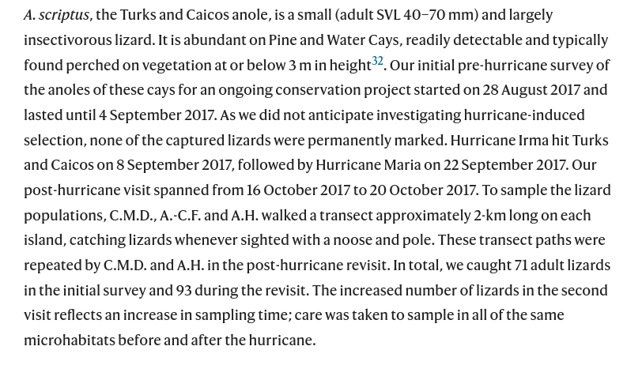
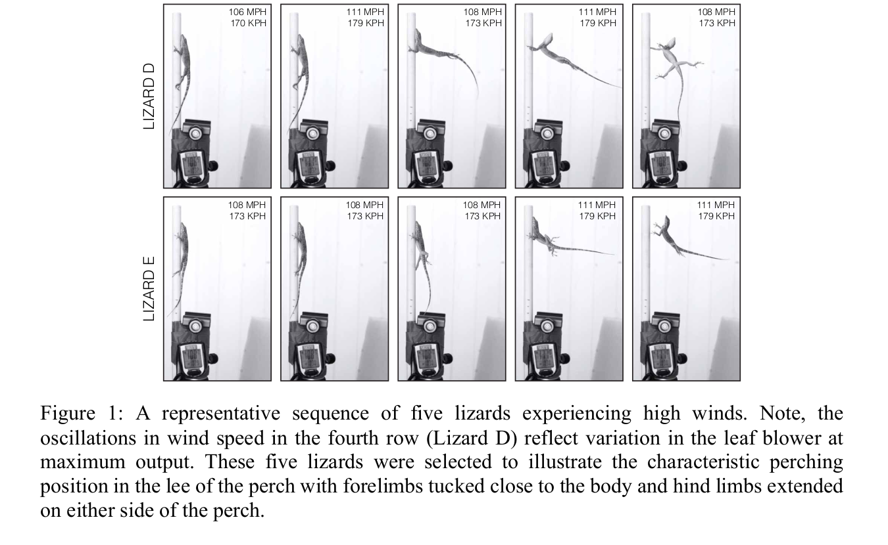

```{r setup, include=FALSE}
fig.dim <- 5
knitr::opts_chunk$set(fig.width=2*fig.dim,
                      fig.height=fig.dim,
                      fig.cap="",
                      fig.align='center')
set.seed(23)
library(tidyverse)
library(patchwork)
library(brms)
library(bayesplot)
library(matrixStats)
options(mc.cores = parallel::detectCores())
options(digits=4)
options(warnPartialMatchDollar=FALSE) # hush, brms
```

# Hurricane lizards

##

**Data from:**
Donihue, C.M., Herrel, A., Fabre, AC. et al. [*Hurricane-induced selection on the morphology of an island lizard.*](https://doi.org/10.1038/s41586-018-0352-3) Nature 560, 88–91 (2018).

```
Anolis scriptus morphology and performance from before and after hurricanes

Lizard morphology data collected from two visits to Pine Cay and Water Cay in
the Turks and Caicos Islands. Anolis scriptus lizards were surveyed on both
islands four days before hurricane Irma and again, six weeks later, after the
islands had been hit by Hurricanes Irma and Maria. We measured morphology and
performance and found significant differences in the "before" and "after"
hurricane lizard population morphology. All linear measurements are in MM,
surface area measurements are in MM2 and force in N. Counts correspond to the
number of lamellar scales on the forelimb and hind limb toepads.
```

##


## {data-background-image="images/lizards-islands.png" data-background-size=80% data-background-position=center}

##


##



##


##



##

Here's the data: [dataset](../datasets/Hurricane_lizards/lizards.csv);
[README](../datasets/Hurricane_lizards/README.html).
First we'll read it in, reorder the levels of the Hurricane factor (so that "before" comes before "after"),
change units on SVL to centimeters so it's on the same scale as the other variables
(useful below),
and drop unused variables.

```{r read_data}
varnames <- c("SVL_cm", "Femur", "Tibia", "Metatarsal", "LongestToe", "Humerus", 
    "Radius", "Metacarpal", "LongestFinger", "FingerCount", "ToeCount", 
    "MeanFingerArea", "MeanToeArea")
lizards <- read.csv("../datasets/Hurricane_lizards/lizards.csv", header=TRUE, stringsAsFactors=TRUE) |>
    mutate(
        Hurricane = factor(Hurricane, levels=c("Before", "After")),
        SVL_cm = SVL / 10) |>
    select(Hurricane, Origin, Sex, all_of(varnames))
head(lizards)
```

-----------

Here's the sample sizes:
```{r look}
with(lizards, table(Sex, Origin, Hurricane))
```

# Let's make a plan

## Brainstorming

- What morphological differences do we expect
    betweeen the "before" and "after" groups of lizards?
- What visualizations can we use to look for these differences? (Sketch them.)
- What statistical analysis can we use?

```{r datahead, echo=FALSE}
head(lizards)
```

## Steps in data analysis

1. Care, or at least think, about the data.

2. Look at the data.

3. Query the data.

4. Check the results.

5. Communicate.


## Ideas

IN CLASS

## Goals

- describe how traits differ before/after hurricanes
- account for confounding factor: overall size
- also possibly account for differences between islands and sexes

. . .

*Exercise:*
Write a possible conclusion sentence or two
(imagining what might happen).
Make sure to communicate
(a) the size of the effect we're looking for, in real-world terms;
(b) the strength of the statistical evidence; and
(c) context
(e.g., how's the size of the hurricane-induced change compare to other differences).


## Examples

We found that the typical ratio of hand size to body size was 10% larger after than before
(t-test, p-value 0.01).
This is roughly 2 standard deviations of the ratios observed within each sex;
ratios do not seem to differ between islands.

The body radius decreased by 20% after the hurricane compared to before.

Metatarsal length increased by 5% after the hurricane (possibly due to incrased grip).

We see that lizards with the longest fingers and toes (5% longer on average) survived better on average (t-test of p=0.01);
they seem to have been able to hold on better during the hurricane.


# Look at the data

## 

```{r hists, warning=FALSE}
lizards_long <- pivot_longer(lizards, col=all_of(varnames), names_to="measurement")
ggplot(lizards_long) + geom_histogram(aes(x=value), bins=20) + facet_wrap(~measurement)
```

##

There is not a huge, obvious shift.
```{r next, warning=FALSE}
ggplot(lizards_long) + geom_boxplot(aes(x=measurement, y=value, col=Hurricane)) +  theme(axis.text.x = element_text(angle = 90, vjust = 0.5, hjust=1)) 
```

------

```{r next2, warning=FALSE}
ggplot(lizards_long) + geom_boxplot(aes(x=measurement, y=value, fill=Hurricane)) +  theme(axis.text.x = element_text(angle = 90, vjust = 0.5, hjust=1)) + facet_wrap(~Sex) 
```

## Everything is correlated with everything else:

```{r pairs, echo=FALSE, fig.width=3*fig.dim, fig.height=2.1*fig.dim}
pairs(lizards[,varnames], pch=20, cex=0.5,
      col=ifelse(lizards$Hurricane == "Before", "black", "red"),
      main="Before (black)/After (red)"
)
```

## Sex and size are almost totally confounded

```{r pairs_sex, echo=FALSE, fig.width=3*fig.dim, fig.height=2.1*fig.dim}
pairs(lizards[,varnames], pch=20, cex=0.5,
      col=ifelse(lizards$Sex == "Male", "black", "red"),
      main="Male (black)/Female (red)"
)
```

## What about island?

```{r pairs_origin, echo=FALSE, fig.width=3*fig.dim, fig.height=2.1*fig.dim}
pairs(lizards[,varnames], pch=20, cex=0.5,
      col=ifelse(lizards$Origin == "Pine Cay", "black", "red"),
      main="Pine Cay (black)/Water Cay (red)"
)
```

------

Let's look at two of those:
```{r plitit, fig.height=1.2*fig.dim, fig.width=2*fig.dim, warning=FALSE, message=FALSE}
p1 <- lizards |> ggplot(aes(x=SVL_cm, y=Femur, color=Hurricane)) +
    geom_point(aes(shape=Sex)) + geom_smooth(method=lm, formula=y~x, se=FALSE)
p2 <- lizards |> ggplot(aes(x=Femur, y=MeanFingerArea, color=Hurricane)) +
    geom_point(aes(shape=Sex)) + geom_smooth(method=lm, formula=y~x, se=FALSE)
p1 | p2
```


# Data analysis

## The plan

- Fit a model (maybe only to one or two measurements)
- check model fit, and
- summarize results.


. . .

*Steps:*

1. choose a formula, and family
2. pick some priors
3. check for convergence
4. visualize results
5. get numerical summaries of what we want


## IN CLASS

Since the sexes are pretty dimorphic,
we'd like to allow a different relationship between measurements
and length, so we're including an interaction between sex and length (`SVL_cm`).
Also, maybe the hurricane had a different effect on the two islands,
so we're including an interaction between hurricane and origin.
The model we're fitting thus has two groups of parallel lines,
one for each sex, with different intercepts,
before and after the hurricane on each island.

```{r bform}
bform <- brmsformula(
    Femur ~ Sex * SVL_cm + Hurricane * Origin
)
```

-----------

```{r bpriors}
get_prior(bform, data=lizards)
```

-----------

```{r bmodel, cache=TRUE}
bmod <- brm(
    bform,
    data=lizards,
    family="gaussian",
    prior=set_prior("normal(0, 10)", class="b")
)    
```

-----------

Convergence looks good: Rhat 1.00!

```{r convergence}
summary(bmod)
```

------------

Fuzzy caterpillars: good!

```{r traces}
mcmc_trace(bmod)
```


--------------

Huh, why isn't this significant?
*(It's because it's predicting for females at the overall-average length.)*

```{r viz, message=FALSE}
conditional_effects(
    bmod,
    effects="Hurricane"
)
```

--------------

Effects for *females* on *Pine Cay*:

```{r viz2, message=FALSE}
conditional_effects(
    bmod,
    effects="SVL_cm:Hurricane"
) |> plot(points=TRUE)
```

--------------


```{r viz3, message=FALSE}
conditional_effects(
    bmod,
    effects="SVL_cm:Hurricane",
    conditions=lizards |> summarise(SVL_cm=mean(SVL_cm), .by=Sex) |> mutate(cond__=Sex)
) |> plot(points=TRUE)
```

## How much do lizards differ?

Looks like the residual SD is about 0.6mm:

```{r resids}
mcmc_hist(bmod, "sigma", bins=40)
```


## Conclusions?

Let's do this in two ways:

1. Use `hypothesis` for the coefficient on `Hurricane`, on each island, to see if they are confidently different than zero.

2. Look at the posterior distribution of the difference in femur length
    between a lizard of average length
    before/after the hurricane (on each island, and of each sex).
    
We should make sure to report the conclusions in concrete and real-world terms.


##  Posterior distribution of diffs

Here's the code to get you started on (2).

```{r posts}
pred_data <- lizards |> summarise(SVL_cm=mean(SVL_cm), .by=c(Sex, Origin))
pred_data <- rbind(
    pred_data |> mutate(Hurricane="Before"),
    pred_data |> mutate(Hurricane="After")
)
# the k-th column in post_samples are the samples from the k-th row of pred_data:
post_samples <- posterior_epred(
    bmod,
    newdata=pred_data
)
```


