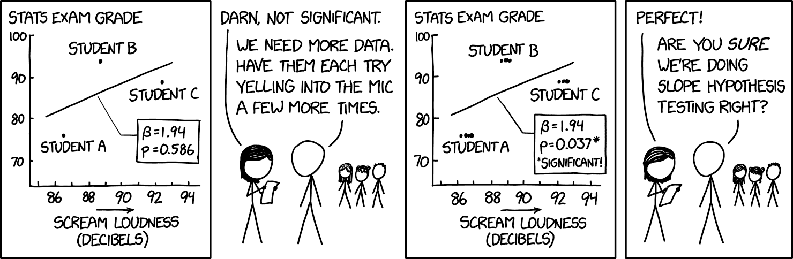

```{r setup, include=FALSE}
fig.dim <- 4
knitr::opts_chunk$set(fig.width=2*fig.dim,
                      fig.height=fig.dim,
                      fig.cap="",
                      fig.align='center')
set.seed(23)
library(tidyverse)
library(matrixStats)
library(lme4)
```


```{r pumpkins, include=FALSE}
pumpkins <- read.table("data/pumpkins.tsv", header=TRUE)
pumpkins$plot <- factor(pumpkins$plot)
```

# Random effects

## An example: sleep

::: {.smaller}

From [Belenky et al](https://doi.org/10.1046/j.1365-2869.2003.00337.x),
*Patterns of performance degradation and restoration during sleep restriction and subsequent recovery: a sleep dose-response study*
(and included in the `lme4` package).


> The average reaction time per day (in milliseconds) for subjects in a sleep deprivation study.
> These data are from the study described in Belenky et al. (2003), for the
> most sleep-deprived group (3 hours time-in-bed) and for the first 10 days of the
> study, up to the recovery period.

:::


```{r sleepdata}
library(lme4)
head(sleepstudy)
```

## How much data do we have?

```{r sltab}
sleepstudy |> summarize(n=n(), Reaction=mean(Reaction), .by=Subject)
```

## Do subjects differ?

```{r pldata, fig.width=2.5*fig.dim, fig.height=1.5*fig.dim}
sleepstudy |> ggplot(aes(x=Days, y=Reaction)) +
    geom_point() + geom_smooth(method="lm", formula=y~x) +
    facet_wrap(~ Subject, nrow=2)
```

## First pass: lm()

```{r lm1}
lm1 <- lm(Reaction ~ Days, data=sleepstudy)
summary(lm1)
```

## How'd that work?

```
Reaction ~ Days
```


```{r plot_lm1, fig.width=2.5*fig.dim, fig.height=1.5*fig.dim}
sleep <- sleepstudy |> mutate( lm1 = predict(lm1, newdata=sleepstudy) )
sleep |> pivot_longer(cols=c(Reaction, lm1), values_to="Reaction", names_to="what") |>
    mutate(what=fct_recode(what, data="Reaction")) |>
    ggplot(aes(x=Days, y=Reaction, color=what)) +
    geom_point() + geom_smooth(method="lm", formula=y~x) +
    facet_wrap(~ Subject, nrow=2)
```

## 

*Critique:*

That single line more or less summarizes how much reaction time goes up per night.

After all, it's what we'd get if we ignored Subject.

But, this is wrong!
```{r plotonce}
sleep |> ggplot(aes(x=Days, y=Reaction)) +
    geom_point(aes(color=Subject)) + geom_smooth(method="lm", formula=y~x)
```

----------

{width=90%}

::: {.caption .floatright}
[xkcd:2533](https://xkcd.com/2533/)
:::

## A reminder: "the" linear model

```
lm(Reaction ~ Days)
```
fits the model ($R_i$ and $D_i$ are the $i^\text{th}$ Reaction and Days entries)
$$\begin{aligned}
    R_i &= b_0 + b_{\text{Days}} \times D_i + \epsilon_i \\
    \epsilon_i &\sim \text{Normal}(\text{mean}=0, \text{sd}=\sigma) ,
\end{aligned}$$
where the $\epsilon_i$ are *independent*.

. . . 

This means that we'll be *wrong*: overconfident about the estimate.

## Separate lines per subject?

```{r lm2, fig.width=2.5*fig.dim, fig.height=1.5*fig.dim}
lm2 <- lm(Reaction ~ Days * Subject, data=sleepstudy)
summary(lm2)
```

----------------------

```
Reaction ~ Days * Subject
```


```{r plot_lm3, fig.width=2.5*fig.dim, fig.height=1.5*fig.dim}
sleep <- sleep |> mutate( lm2 = predict(lm2, newdata=sleepstudy) )
sleep |> pivot_longer(cols=c(Reaction, lm2, lm1), values_to="Reaction", names_to="what") |>
    mutate(what=fct_recode(what, data="Reaction")) |>
    ggplot(aes(x=Days, y=Reaction, color=what)) +
    geom_point() + geom_smooth(method="lm", formula=y~x) +
    facet_wrap(~ Subject, nrow=2)
```

## What'd we do there?

```
lm(Reaction ~ Days * Subject)
```
fits the model ($R_i$, $D_i$ and $S_i$ are the $i^\text{th}$ Reaction, Days, and Subject entries)
$$\begin{aligned}
    R_{i} &= b_{S_i,0} + b_{S_i,\text{Days}} \times D_i + \epsilon_i \\
    \epsilon_i &\sim \text{Normal}(\text{mean}=0, \text{sd}=\sigma) .
\end{aligned}$$
The $\epsilon_i$ are still independent, but there's a different slope and intercept for each subject.

. . .

**But** we wanted to know the *overall* effect!

# Random effects

------------

Here's one approach:
$$\begin{aligned}
    R_{i} &= b_0 + b_\text{Days} \times D_i + b_{S_i,0} + b_{S_i,\text{Days}} \times D_i + \epsilon_i \\
    \epsilon_i &\sim \text{Normal}(\text{mean}=0, \text{sd}=\sigma)  \\
    b_{S_i,0}  &\sim \text{Normal}(\text{mean}=0, \text{sd}=\eta) \\
    b_{S_i,\text{Days}}  &\sim \text{Normal}(\text{mean}=0, \text{sd}=\eta) \\
\end{aligned}$$
We're allowing *subject-specific deviations*
from a common slope and intercept.

## `lme4::lmer`

*This* has *random intercepts and slopes* by subject:
```{r lmer}
fm1 <- lmer(Reaction ~ Days + (Days | Subject), data=sleepstudy)
summary(fm1)
```

------------------

Here are the estimated random effects themselves:
```{r plot_ranefs}
rf1 <- ranef(fm1) |> as.data.frame()
rf1 |> ggplot(aes(y=grp, x=condval)) +
    geom_point() + facet_wrap(~term, scales="free_x") +
    geom_errorbar(aes(xmin=condval -2*condsd,
                      xmax=condval +2*condsd), width=0) +
    labs(x="coefficent", y="subject")
```

-------------------

And, the per-subject results:

```{r plot_lm2, fig.width=2.5*fig.dim, fig.height=1.5*fig.dim}
sleep <- sleep |> mutate(
    rf1 = predict(fm1, newdata=sleepstudy)
)
sleep |> pivot_longer(cols=c(Reaction, lm2, lm1, rf1), values_to="Reaction", names_to="what") |>
    mutate(what=fct_recode(what, data="Reaction")) |>
    ggplot(aes(x=Days, y=Reaction, color=what)) +
    geom_point() + geom_smooth(method="lm", formula=y~x) +
    geom_abline(slope=fixef(fm1)["Days"], intercept=fixef(fm1)["(Intercept)"]) +
    facet_wrap(~ Subject, nrow=2)
```


# Another example: urchins

## An example: urchins eat algae

From Logan:

> To investigate density-dependent grazing effects of sea urchin Andrew and Underwood
> (1993) on filamentous algae measured the percentage of filamentous algae within five
> quadrats randomly positioned within each of four random patches of reef that were in turn
> nested within four sea urchin density treatments (no urchins, 33% of natural density, 66%
> natural density and 100% natural density). The sea urchin density treatment was considered
> a fixed factor and patch within density treatment as well as the individual quadrats were
> treated as random factors.

## An example: urchins eat algae

```{r andrewdata}
andrew_data <- read.table('../datasets/Logan_data/andrew.tsv', header=T, sep='\t')
head(andrew_data)
```

There are four variables: `TREAT`, `PATCH`, `QUAD` and `ALGAE`

Main effect factor: `TREAT`

. . .

Both `QUAD` and `PATCH` are factors:
```{r factorit}
andrew_data$QUAD <- factor(andrew_data$QUAD)
andrew_data$PATCH <- factor(andrew_data$PATCH)
andrew_data$TREAT <- factor(andrew_data$TREAT, levels=c("0%", "33%", "66%", "100%"))
```


## Experimental design

```{r tableit}
with(andrew_data, table(PATCH, QUAD, TREAT))
```

## Response distribution

```{r boxit, fig.width=2.5*fig.dim, fig.height=1.5*fig.dim}
andrew_data |> mutate(patch_num=factor(as.numeric(PATCH)%%4)) |> 
    ggplot(aes(x=TREAT, y=ALGAE)) + geom_boxplot() +
    geom_jitter(aes(color=patch_num))
```

##

Why is this wrong?

```{r lme_urchins}
summary(lm(ALGAE ~ TREAT, data=andrew_data))
```


##

What we really want:
$$
\text{(algae)} = \text{(mean for treatment)} + \text{(mean offset for patch)} + \text{("noise")} .
$$

. . .

We *could* do:
```
ALGAE ~ TREAT + PATCH
```
... but do we care about all those patch means?

##

```{r do_biglm}
summary(lm(ALGAE ~ TREAT + PATCH, data=andrew_data))
```

## Random effects

Small modification:
$$
\text{(algae)} = \text{(mean for treatment)} + \text{(random offset for patch)} + \text{("noise")} .
$$

. . .

We add a *random intercept*:
```
ALGAE ~ TREAT + (1|PATCH)
```

## 

```{r do_lmer}
library(lme4)
alglm <- lmer(ALGAE ~ TREAT + (1|PATCH), data=andrew_data)
summary(alglm)
```

##

```{r compare_lmer}
anova(
      lmer(ALGAE ~ TREAT + (1|PATCH), data=andrew_data),
      lm(ALGAE ~ TREAT, data=andrew_data))
```

##

```{r compare_lmer2}
anova(
      lmer(ALGAE ~ TREAT + (1|PATCH), data=andrew_data),
      lmer(ALGAE ~ (1|PATCH), data=andrew_data))
```


## What *are* the random effects?

```{r ranef}
ranef(alglm)
```

##

```{r plot_ranef}
ranef(alglm) |> as.data.frame() |> ggplot(aes(y=grp, x=condval)) +
    geom_point() + facet_wrap(~term, scales="free_x") +
    geom_errorbar(aes(xmin=condval -2*condsd,
                      xmax=condval +2*condsd), width=0) +
    labs(x="mean offset", y="patch number")
```

# Notes on mixed models

## The math is a lot harder.

For a simple linear model fit by `lm( )` (with *fixed effects*),
the *log-likelihood function* is just the sum of the squared residuals.

. . .

But with a *mixed model*, the likelihood *averages* over the values of the random effects,
which makes everything more difficult.

## You sometimes have to worry about *convergence*.

Since the math is harder,
mixed-model-fitting functions like `lmer( )` have to use various sorts of *numerical optimization* methods
to find the best-fitting parameters.

. . .

Sometimes, these may fail.

. . .

Notably, many use the [`REML`](https://en.wikipedia.org/wiki/Restricted_maximum_likelihood) approximation:
```
Usage:

     lmer(formula, data = NULL, REML = TRUE, control = lmerControl(),
          start = NULL, verbose = 0L, subset, weights, na.action,
          offset, contrasts = NULL, devFunOnly = FALSE, ...)
```

## Hypothesis testing?

With fixed effects, for a factor `f`, the comparison
```
anova( lm(y ~ f - 1), lm(y ~ 1) )
```
uses the model that
$$ y_i = \beta_{f_i} + \epsilon_i $$
to test against the null hypothesis that
$$ H_0 : \beta_1 = \beta_2 = \cdots = \beta_m = 0. $$

-----------

With *random* effects,
```
anova( lm(y ~ (1|f) - 1), lm(y ~ 1) )
```
uses the model that
$$\begin{aligned} 
    y_i &= \beta_{f_i} + \epsilon_i   \\
    \beta_a &\sim \Normal(0, \eta) 
\end{aligned}$$
to test against the null hypothesis that
$$ H_0 : \eta = 0. $$


# Back to the pumpkins

## Your turn

1. Adjust the simulations so that
   there is an effect of `plot`, drawn randomly from Normal(0, 1).
2. Fit a model including a *random effect* for `plot`.
3. How big is the "plot" effect? Is it estimated correctly?
4. Assess significance by using `anova( )` to compare to a nested model.


## Simulate data

(Here's our previous code:)
```{r simdata}
pumpkins <- expand.grid(
          fertilizer=c("low", "medium", "high"),
          water=c("no water", "water"),
          plot=1:4,
          plant=1:5,
          weight=NA)

params <- list(
    mu = 5, # all units are kg
    alpha = c(low=0, medium=2, high=4),
    beta = c("no water"=0, water=1),
    sigma = 1
)
params$gamma <- rep(0, 6)
names(params$gamma) <- outer(c("low", "medium", "high"), c("no water", "water"), paste, sep=",")
params$gamma["high,water"] <-  5

pumpkins$condition <- paste(pumpkins$fertilizer, pumpkins$water, sep=",")
pumpkins$mean_weight <-
    params$mu +
    params$alpha[pumpkins$fertilizer] +
    params$beta[pumpkins$water] +
    params$gamma[pumpkins$condition]

set.seed(123)
pumpkins$weight <- rnorm(nrow(pumpkins), mean=pumpkins$mean_weight, sd=params$sigma)
```
